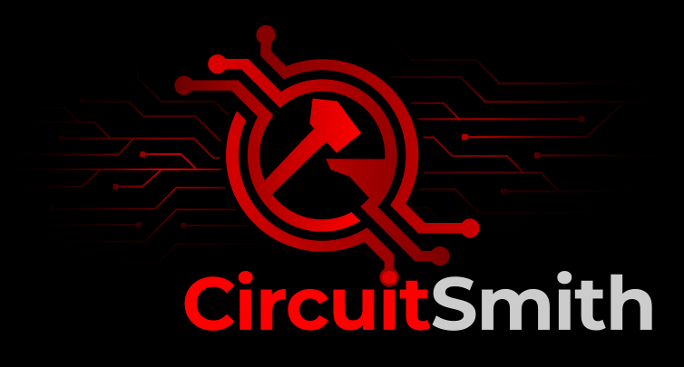

# CircuitSmith (powered by HephAIstus Core)

<p align="center">
  
</p>

CircuitSmith is an AI copilot for KiCad schematic design and circuit simulation, powered by the **HephAIstus** deterministic circuit and simulation engine.

It sits beside KiCad, understands schematic and simulation context, answers engineering questions, and applies previewable, validated changes without requiring the user to copy files, screenshots, or console output into an external chat.

### Naming & Architecture Boundary

- **CircuitSmith** — User-facing product brand, companion UI, LLM copilot persona, and project session directory (`.circuitsmith/`).
- **HephAIstus** — Protected internal engine codename (`hephaistus_*` Python packages, `hephaistus-*` CLI entrypoints, and `hephaistus/patch-plan/v1` protocol schema).

## What's New (2026-09-05)

### B-Source & SPICE Simulation Fixes

- **Sim.Device fix:** Behavioral sources (B-sources) now correctly use `Sim.Device = "SPICE"` instead of `"B"`, ensuring proper SPICE netlist generation
- **Sim.Params visibility:** Fixed property visibility — `Sim.Params` must be visible in schematic (no `(hide yes)`) for correct SPICE export
- **Library inclusion:** Added support for `.include` directives to include SPICE subcircuit libraries

### Companion UI Improvements

- **Dialog close fix:** Fixed race condition where Load Schematic dialog wouldn't close properly when triggered from header button
- **Better UX:** Removed native `prompt()` dialogs in favor of React-managed state; improved form styling and keyboard navigation

## Documentation Guide

### Start Here

- **[`CONTEXT.md`](CONTEXT.md)** — Project summary, architecture overview, and document map. Start here if you're new to the project.
- **[`docs/vision.md`](docs/vision.md)** — One-sentence mission, problem statement, and operating principles.

### By Task

| Task | Read |
|------|------|
| Understanding the product | `docs/vision.md` → `docs/spec.md` |
| Architecture and components | `docs/ARCHITECTURE.md` |
| Patch operations (LLM output contract) | `docs/patch-plan-v1.md` |
| User experience scenarios | `docs/use_cases_blueprint.md` |
| Testing procedures | `docs/TEST-MANUAL.md` |
| Implementation deep dives | `backend/hephaistus_circuit/IMPLEMENTATION.md`, `backend/hephaistus_context/IMPLEMENTATION.md` |
| LLM context assembly | `docs/LLM_CONTEXT.md` |

### Reference Documents

| Document | Scope |
|----------|-------|
| `docs/spec.md` | Product specification: workflows, validation gates, acceptance criteria |
| `docs/ARCHITECTURE.md` | Technical architecture: components, data flow, implementation status |
| `docs/patch-plan-v1.md` | JSON schema for LLM-produced mutation plans |
| `docs/use_cases_blueprint.md` | User stories and milestone mapping |
| `docs/TEST-MANUAL.md` | Manual test procedures |
| `docs/migration-from-vscode-prototype.md` | Historical context for the VS Code extension archive |

## Product Direction

The target workflow is:

1. Open a KiCad schematic or simulation window.
2. Ask CircuitSmith about the circuit, ERC report, simulation parameters, console output, or waveform results.
3. Receive explanations or a deterministic patch plan (`hephaistus/patch-plan/v1`).
4. Preview the proposed change.
5. Apply it only after validation.
6. Re-run ERC and/or simulation automatically.
7. Keep an auditable history with rollback information.

## Implementation Status

### Completed ✅

| Component | Description |
|-----------|-------------|
| KiCad ingestion | Parse `.kicad_sch` to JSON state |
| Patch operations | 7 operation types with validation |
| Stub-based restructuring | Series insertions, net reassignments |
| SPICE property inheritance | Auto-copy `Sim.*` properties from libraries |
| B-Source generation | Behavioral sources with correct `Sim.Device = "SPICE"` |
| Simulation output parsing | Ngspice console, DC op, raw waveforms |
| Session persistence | Project-scoped sessions in `.circuitsmith/` |
| LLM context assembly | Token-budgeted layered context |
| Companion UI | React-based chat, context inspector, history |
| Dialog management | Proper React state management for dialogs |

### Known Issues

- KiCad/ngspice plugin loading errors (`ivlng.so`, `ivlng.vpi`) may appear in console — these are environmental warnings that may not affect simulation
- SPICE library files (`.lib`) must be manually included via `.include` directive in schematic for custom subcircuits

### In Progress

- Simulation execution (beyond ingestion)
- KiCad IPC integration (future)

## Quick Start (Running CircuitSmith Locally)

You need two terminals — one for the **HephAIstus backend API** (`port 8000`) and one for the **CircuitSmith Companion UI** (`port 3000`).

### 1. Terminal 1 — Start the Backend API (`port 8000`)

```bash
cd ~/.openclaw/workspace/hephaistus
source .venv/bin/activate

# First-time setup only (if needed):
# pip install -e .

# Start the API server (with hot-reload):
hephaistus-api
# Or directly: python backend/api/server.py
```
> **LLM Providers:**
> - **Ollama (local):** Ensure `ollama serve` is running.
> - **OpenRouter (cloud):** Set `OPENROUTER_API_KEY=sk-or-...` in `.env` at the repo root or export it in your shell.

### 2. Terminal 2 — Start the Companion Web UI (`port 3000`)

```bash
cd ~/.openclaw/workspace/hephaistus/companion
# npm install   # First-time setup only
npm run dev
```

### 3. Open in Browser
- **CircuitSmith UI:** http://localhost:3000
- **API Swagger Docs:** http://localhost:8000/docs

Once open at `http://localhost:3000`, click **📁 Load** in the top header to load a `.kicad_sch` schematic. Session state, conversation history, and simulation runs are automatically saved in `<project>/.circuitsmith/`.

## Branch Information

- Active branch: `feature/companion-reset`
- Archive: `archive/vscode-prototype` (tag: `vscode-prototype-2026-08-19`)

## License

[License information here]